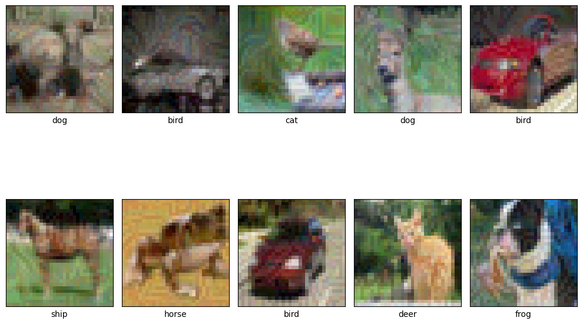
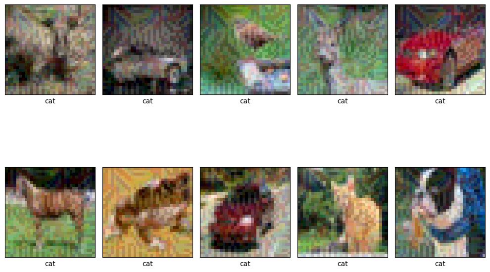
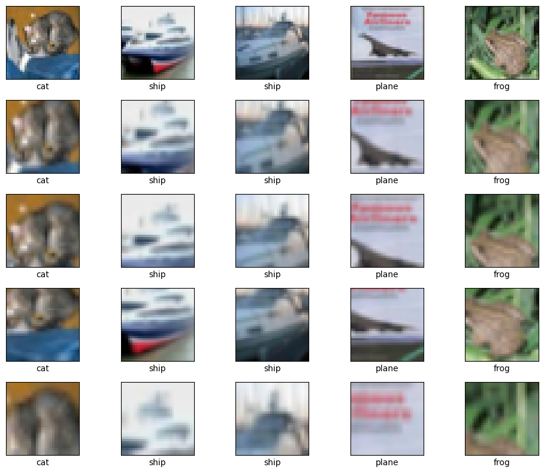
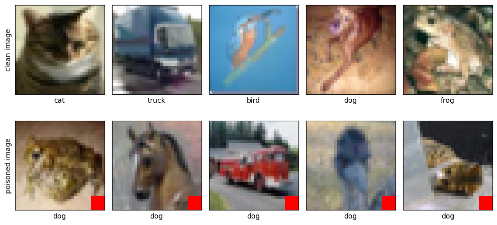
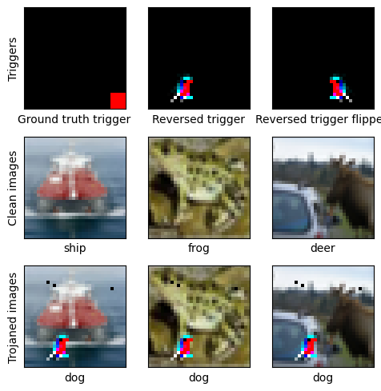
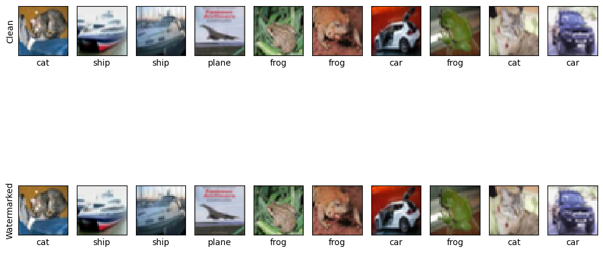

# Adversarial ML: Attacks and Defences on Image Classifiers

PyTorch implementations of seven attacks and defences from AI security research, tested against VGG11-BN classifiers on CIFAR-10. They cover three areas:

- **Evasion**: fooling a model at test time (grey-box transfer attack, universal perturbation, adaptive attack on a randomised defence).
- **Backdoors**: hiding a trigger in a model and recovering it again (module backdoor, Neural Cleanse-style trigger reverse engineering).
- **Model IP protection**: fingerprint evasion and image watermarking.

## Results

| Area | Technique | Setting | Result |
|---|---|---|---|
| Evasion | [Grey-box transfer attack](advml/attacks/greybox_transfer.py) | targeted, L∞ ≤ 0.04, no victim gradients | **87%** targeted success |
| Evasion | [Universal adversarial perturbation](advml/attacks/uap.py) | one perturbation for all images, L∞ ≤ 0.06 | **94%** of images → "cat" |
| Evasion | [EOT adaptive attack](advml/attacks/eot_adaptive.py) | vs. random-crop majority-vote defence | **94%** (normal examples: 11%) |
| Backdoor | [Module backdoor](advml/backdoor/module_backdoor.py) | 22K-param add-on module (0.08% of victim) | **95.3%** attack success, **0.00%** clean-accuracy drop |
| Backdoor | [Trigger reverse engineering](advml/backdoor/trigger_reverse.py) | no prior on trigger location, shape or colour | **99.3%** success with recovered trigger |
| Model IP | [DeepJudge evasion](advml/ip_protection/deepjudge_evasion.py) | data-free, fingerprints unknown | detection defeated, **−0.41%** accuracy |
| Model IP | [Deep watermarking](advml/ip_protection/watermark.py) | 16-bit message, all bits must match | **100%** TPR, **0%** FPR |

The victim models reach about 87% clean test accuracy.

## How each technique works

### 1. Grey-box transfer attack
Threat model: the attacker knows the victim's architecture and training recipe and can query its outputs, but can **never back-propagate through it**.

1. Train three VGG11-BN surrogates with different seeds.
2. Train a fourth "knock-off" surrogate by distilling the victim's soft labels at temperature 6 (about 90% agreement with the victim on the test set).
3. Warm-start with a high-confidence targeted Carlini-Wagner L2 attack on a weighted ensemble, where the knock-off gets 70% of the weight. Then project the result into the L∞ ball.
4. Refine with momentum PGD on rotating sub-ensembles. Input diversity (random resize and pad) and Gaussian-smoothed gradients improve transferability.
5. Query the victim (forward passes only) and keep the strongest candidate for each image.



### 2. Universal adversarial perturbation
One `[3, 32, 32]` tensor, added to every image, is optimised with Adam. The loss is targeted cross-entropy plus a margin hinge. Three random restarts are run and the best one is kept.



### 3. Adaptive attack against a randomised defence
The defence randomly crops 20–50% of the image 21 times and takes a majority vote. This is non-differentiable and stochastic, and it drops ordinary adversarial examples to 11% success. The attack uses **Expectation over Transformation**: every PGD step averages the loss over 12 crops drawn from the defence's own distribution. Images that still resist get a higher loss weight, and candidates are scored over 105 fresh crops.



### 4. Module backdoor (TrojanNet-style)
The victim's weights stay untouched. A tiny CNN learns to output zeros on clean images and a strong "dog" logit when a 5×5 red square sits in the corner. Its logits are added to the victim's. After training, the module's mean clean logit is subtracted from its bias, so clean accuracy is unchanged.



### 5. Trigger reverse engineering (defence)
Following Neural Cleanse, the attack optimises a full-image pattern and a soft mask so that `(1 − m)·x + m·p` is classified as the target label. The loss adds an L1 penalty on the mask and a total-variation term. The L1 cost adapts during training: it rises while the attack still succeeds and falls when it starts to fail. This keeps shrinking the mask until only the real trigger remains. The recovered trigger appears **mirrored**, because the victim was trained with horizontal flips.



### 6. Data-free DeepJudge evasion
DeepJudge detects stolen models by testing them on secret adversarial "fingerprints". A horizontal flip plus a 1-pixel reflect-padded shift barely affects natural images, but it breaks the brittle fingerprints. After the transform, RobD is 0.599 and JSD is 0.354, both above the detection thresholds of 0.388 and 0.226. Detection is defeated without any data and without knowing the fingerprints.

### 7. Deep image watermarking
A perturbation generator and a bit decoder are trained jointly. The decoder learns to read a 16-bit message from watermarked images and all zeros from clean ones. The distortion penalty ramps from 0.1 to 2.5 over training, so the watermark ends up barely visible while staying perfectly decodable.



## Project layout

```
advml/
  common.py                 CIFAR-10 helpers, VGG11-BN, training recipe
  attacks/                  greybox_transfer, uap, eot_adaptive
  backdoor/                 module_backdoor, trigger_reverse
  ip_protection/            deepjudge_evasion, watermark
examples/                   end-to-end demos (train a victim, then attack it)
assets/                     result figures from the original runs
```

## Running

```bash
pip install -r requirements.txt
python -m examples.demo_evasion --attack all   # grey-box, UAP, EOT
python -m examples.demo_backdoor               # module backdoor + trigger recovery
python -m examples.demo_watermark              # watermark training + evaluation
```

CIFAR-10 downloads to `data/` automatically. Models and checkpoints go to `out/`. A GPU is strongly recommended: the grey-box attack alone trains four VGG11 models.

## Notes

- The results above come from the original runs on a Kaggle GPU. The victim models in those runs were pretrained models provided for the course. The demo scripts train their own victims instead, so numbers will differ slightly.
- The CW L2 warm start uses [CleverHans](https://github.com/cleverhans-lab/cleverhans) (MIT licence).
- Developed as part of a university course on AI and cybersecurity. Everything here is for research and education on model robustness.
